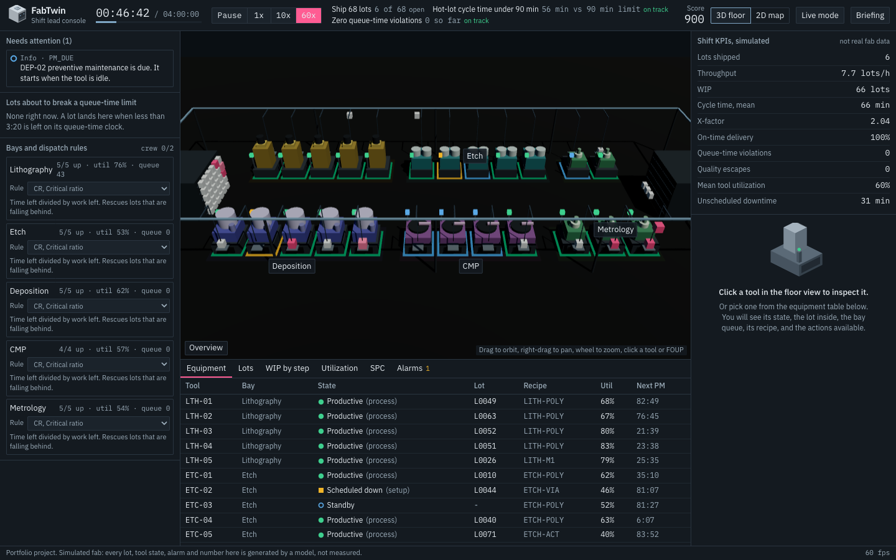
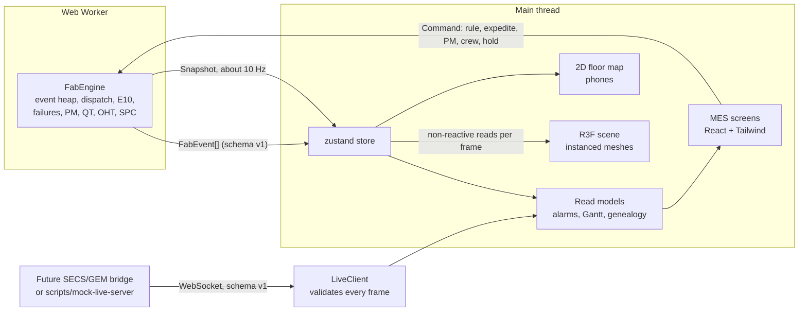

# FabTwin

A semiconductor fab manufacturing execution system (MES) with a deterministic discrete-event simulation underneath, played as a 3D shift-lead game.

You run the shift of a small 300 mm fab: five bays, 24 tools, two stockers and an overhead hoist transport (OHT) loop carrying FOUPs. Lots follow 12 to 20 step re-entrant routes. You change dispatch rules, expedite and hold lots, send tools to preventive maintenance early and decide which down tool gets one of two repair crews. The shift ends with a score and a report that explains what drove it, measured against an autopilot run of the same seed.



> **Portfolio project, simulated fab.** There is no real equipment, customer or production data anywhere in this repository. Every lot, tool state, alarm and KPI is generated by the model, and the interface says so wherever KPIs appear.

## What is in it

| Layer | What it does |
|---|---|
| `src/sim` | The engine. Pure TypeScript, no DOM. Event heap, routing, dispatch rules, SEMI E10 tool states, MTBF/MTTR failures, PM, queue-time limits, OHT transport, SPC, KPIs, scoring. |
| `src/worker` | Hosts the engine in a Web Worker and advances it at 1x, 10x or 60x. |
| `src/events` | The versioned JSON event schema, validator, JSON Schema, and a WebSocket live client. |
| `src/store` | Zustand store plus event-sourced read models (alarm log, Gantt segments, lot genealogy). |
| `src/scene` | React Three Fiber scene. All geometry is procedural and instanced. |
| `src/ui` | MES screens, tool and lot panels, charts (hand-written SVG), 2D floor map, dialogs. |
| `src/art` | Original isometric SVG illustrations of a FOUP, a process tool and a wafer. |

## Architecture



Two data paths run from the worker. The **event stream** (equipment state changes, alarms, lot start and complete, collection events) is the same format a real bridge would send, and the console builds its alarm list, Gantt and lot genealogy only from it. The **snapshot** carries what a stream cannot, such as queue contents and vehicle plans, and feeds the 3D scene. Because the read models depend on events only, live mode is a drop-in source.

## Simulation model

The shift is **4 simulated hours**, time-compressed: process steps take 1 to 3 minutes where a real step takes tens of minutes, so lots finish within a shift. The model keeps the shape of fab behaviour (re-entrancy, a constraint bay, queueing, downtime) while compressing the clock.

**Layout.** Five bays and 24 tools: lithography 5, etch 5, deposition 5, CMP 4, metrology 5. Two stockers. A 304 m rectangular OHT loop with 14 vehicles at 6 m/s, 4 s load and unload dwell. Tools sit in two rows facing the loop, each with a load port and a hoist drop. Every move is tool to stocker or stocker to tool, so a lot step costs two transports.

**Routes.** Three products, 12, 16 and 20 steps, mix 30/40/30 percent. Every route returns to lithography at least three times (3, 4 and 5 visits). Hot lots are 12 percent of releases with a due date of 2.4 times raw process time, against 5 times for normal lots. A WIP cap of 66 lots limits release (CONWIP).

**Queue-time limits.** Etch steps must start within 10 minutes of the previous step finishing, tungsten deposition and CMP within 12 minutes. At 75 percent of the allowance the lot raises a warning and every dispatch rule serves it first. At 100 percent it is a violation: an alarm, a collection event, a score penalty, and a 20 percent longer re-clean on that step.

**Tool states (SEMI E10).** Productive, standby, engineering, scheduled down, unscheduled down.

| Transition | Cause |
|---|---|
| standby to scheduled down | Recipe setup (20 to 45 s depending on bay) or PM |
| scheduled down to productive | Setup done, process starts |
| scheduled down to engineering | PM finished, qualification run (90 s) |
| any up state to unscheduled down | Failure |
| unscheduled down to engineering | Repair finished, requalification |
| engineering to standby | Qualified |

The engine throws on any other transition, and a test checks the full event stream of a shift against the same table.

**Reliability.** Time to failure is Weibull (shape 2, so wear-out) with the tool's MTBF as the mean, restarted at every PM or repair. MTBF is 82 to 140 minutes by bay, with one flaky tool per bay and a 0.65 to 1.35 spread. Repair time is 0.6 to 1.5 times the tool's MTTR (8 to 15 minutes). 70 percent of failures are preceded by a degradation warning 15 minutes ahead, which is what makes PM-early a decision. PM is due every 77 to 120 minutes, starts when the tool is next idle, and cancels a pending failure. **Repairs need a crew and there are two.** PM does not need one, on the assumption that a dedicated PM team exists.

**Dispatching.** Each bay runs one rule. A free tool (or one about to finish, with a 45 s pre-stage window) picks from the lots waiting for its bay. An expedited lot goes first, then a lot with a nearly spent queue-time clock, then the rule decides.

| Rule | Orders by |
|---|---|
| FIFO | Time the lot became ready |
| EDD | Due date |
| CR | (due - now) / (remaining raw time + 60 s per remaining step), lowest first |
| SETUP | Lots matching the loaded recipe first, then FIFO |

Ties break on lot id, so ordering is total.

**SPC.** Metrology steps measure CD, overlay or film thickness. A measurement is the target plus the tool bias and drift of the lot's upstream process tool, plus noise. Drift random-walks with each lot processed, and process excursions (a 2.5 to 3.5 sigma shift) arrive at random on litho, deposition and CMP tools until PM resets them. Western Electric rules 1 to 4 run on the combined chart of each parameter. A rule 1 break auto-holds the lot. Releasing it before the suspect tool is serviced keeps an excursion flag, and a flagged lot that ships is a quality escape. After 15 minutes an unreviewed hold is released by default.

**Determinism.** The same seed gives the same shift. Randomness is counter-based (`hash(seed, keys...)`), not a shared stream, so a tool's third failure is the same failure whether or not the player did anything else, and the autopilot comparison is a like-for-like run. Chopping time into different step sizes changes nothing (tested), and a command log replays to the identical result.

**Score.** 100 per lot shipped, 500 for the shipment objective, 400 for hot-lot cycle time, 500 for zero violations, up to 300 for on-time delivery, minus 120 per queue-time violation and 150 per quality escape. Grades: S needs every objective and a score at least 10 percent above autopilot.

### Assumptions worth knowing

- Single-lot processing on every tool, no batch tools, no cascading or cluster tools.
- All tools in a bay are qualified for every recipe of that bay. A setup costs time but no tool is restricted.
- Lots reach a tool only through a stocker. There is no direct tool to tool handoff.
- Transport is a single-direction loop with no vehicle collisions or blocking. A vehicle takes the lot at its pickup port and travels forward.
- Warm-start WIP (48 lots) begins mid-route with a synthetic age, so early cycle times include time before the shift.
- Failures, drift and excursions are drawn from distributions chosen for gameplay, not fitted to a real fab.
- The 4-hour shift stands in for a day of flow. Absolute times are not realistic. Ratios (X-factor around 3, litho utilisation around 75 percent) are in a plausible range.

## The information system

| Screen | Where | Notes |
|---|---|---|
| Attention queue | left rail | Active alarms with one-click actions, lots near a queue-time limit, per-bay rule selector |
| Tool panel | right rail, or click a tool in 3D | State, current lot, bay queue, loaded recipe, time-in-state bar, recent alarms, PM and crew actions |
| Lot panel | right rail | Route strip, queue-time clock, hold, release, expedite, full genealogy |
| Equipment | dock tab | All tools, state, lot, recipe, utilisation, next PM |
| Lots | dock tab | Search by id, route, recipe or tool, filter hot, held, queue-time risk, shipped |
| WIP by step | dock tab | Lots in flight per process step, split into in tool, moving, waiting, held |
| Utilization | dock tab | Gantt of E10 states per tool, whole shift or last hour |
| SPC | dock tab | I-chart per parameter with 1, 2, 3 sigma lines, violation markers and the suspect tool |
| Alarms | dock tab | Set and cleared log, active-only filter |
| Shift report | after the shift | Grade, itemised score, drivers, you against autopilot, tool downtime, your actions, replay download |

## 3D

React Three Fiber and drei, with every model built from boxes and cylinders in code. No downloaded models or textures.

- **Instancing.** The whole floor is a handful of draw calls: one `InstancedMesh` for all boxes (about 450 parts), one for cylinders, one each for status lamps, floor pads and warning markers, one for vehicles and one for FOUPs (up to 200). Colour is per instance, so a tool changing state rewrites 12 bytes.
- **One key light.** A single shadowed directional light plus a dim hemisphere fill. The shadow map is rendered once, since scenery is static.
- **Readable state.** Each tool has a lamp on a light tower and a tinted floor pad in its E10 colour. An amber marker appears over a tool with a degradation warning.
- **FOUPs move.** Lots sit on tool ports and stocker faces, and lift to a vehicle and lower at the destination as the vehicle's planned legs play out. Hot lots are rose and larger.
- **Camera.** Orbit, pan, zoom with damping, an Overview button and per-bay focus (bay labels in the scene and the bay list).
- **Per-frame work.** Vehicle and FOUP matrices are written straight into instance buffers from a `useFrame` loop that reads the store without subscribing, so React does not re-render at frame rate.

On phones, or when WebGL is unavailable, the 3D scene is not mounted. A 2D SVG floor map with the same data takes its place, with a bottom tab bar and 44 px targets. Desktop users can switch between the two.

## Event schema and live mode

Events are versioned JSON (`v: 1`): `equipment.state_changed`, `alarm.set`, `alarm.cleared`, `lot.started`, `lot.completed` and `collection_event`. Full reference in [docs/EVENT_SCHEMA.md](docs/EVENT_SCHEMA.md), machine-readable in [docs/fabtwin-event.schema.json](docs/fabtwin-event.schema.json).

```json
{
  "v": 1, "seq": 412, "t": 1768197660000, "source": "fabtwin-sim",
  "type": "equipment.state_changed",
  "data": { "toolId": "LTH-03", "from": "STANDBY", "to": "SCHEDULED_DOWN", "reason": "setup", "lotId": "L0045" }
}
```

Every event of a simulated shift is validated against the JSON Schema and the runtime validator in the test suite. **Live mode** (top bar) connects to a WebSocket sending one event, an array, or `{ "events": [...] }`, validates every frame, drops invalid ones with a count, and reconnects with backoff. To try it without equipment:

```bash
npm run mock-live        # ws://localhost:8787, replays a simulated shift at 30x
```

Then open the app, choose Live mode and connect. In live mode the simulator pauses, and the equipment table, Gantt, alarms, tool panels and genealogy follow the socket. A separate SECS/GEM simulator project is planned to produce this stream from real equipment messages.

## Run it

Node 22 or newer.

```bash
npm ci
npm run dev          # http://localhost:3000
npm run build && npm start
```

## Test it

```bash
npm test             # 61 tests, about 2 seconds, no browser needed
npm run lint
npm run typecheck
npm run calibrate    # autopilot KPIs over several seeds, used to set the objectives
```

What the tests cover: routing and re-entrancy, dispatch-rule ordering and tie-breaking, the E10 transition table and every transition in a full simulated shift, queue-time warning and violation detection, determinism (same seed, different step sizes, command replay, failure stability), player commands, SPC rules, the post-shift report, the event schema against both validators, the live client's reconnect behaviour and the event read models.

CI (`.github/workflows/ci.yml`) runs lint, typecheck, tests and the production build.

## Layout

```
src/sim        engine, config, dispatch rules, E10, SPC, score, report, tests
src/events     schema types, validator, live client
src/worker     worker host and message protocol
src/store      zustand store and event read models
src/scene      procedural 3D scene
src/ui         MES screens and charts
src/art        isometric SVG illustrations
scripts        calibrate.ts, mock-live-server.ts
docs           event schema, screenshots
DESIGN.md      design direction
```

## Known limitations

- The model is a game-shaped abstraction, not a validated fab model. See the assumptions above.
- The OHT loop has no blocking, so vehicles can overlap on the track.
- Live mode drives equipment states, alarms and lot events only. FOUP motion and KPIs need the simulator's snapshot.
- Touch is supported on the 2D map. The 3D scene is built for mouse and trackpad, and is off by default on phones.
- Dark theme only (see DESIGN.md for why).

## License

MIT. See [LICENSE](LICENSE). Contributions: [CONTRIBUTING.md](CONTRIBUTING.md).
